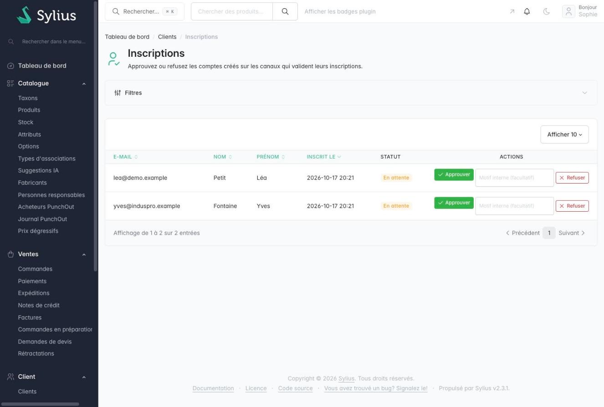
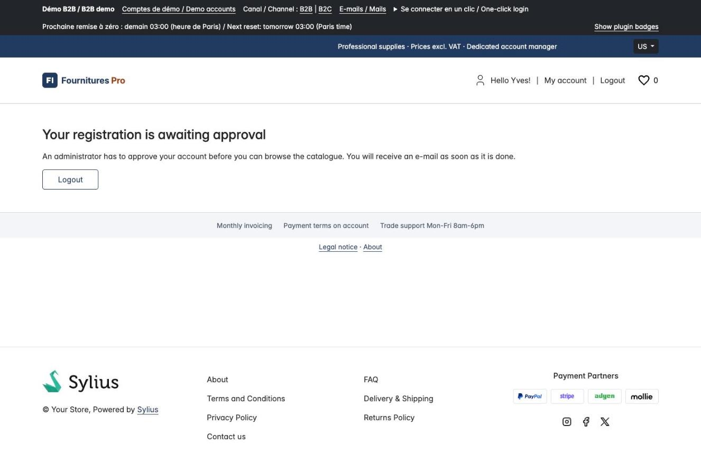

# Sylius Registration Approval Plugin

> English: [README.md](README.md) <!-- vitrine:lang -->

[](https://github.com/thibmonier/sylius-registration-approval-plugin/actions/workflows/build.yaml)
[](LICENSE)

**N'ouvrez un catalogue B2B qu'à de vrais clients : les comptes créés sur certains canaux attendent qu'un
administrateur les approuve ou les refuse.**

Construit sur [`tmonier/sylius-channel-access-plugin`](https://github.com/thibmonier/sylius-channel-access-plugin) :
ce plugin ferme un canal (ou masque ses prix) aux visiteurs non connectés ; celui-ci
fait d'un client dont l'inscription n'est pas approuvée un tel visiteur.

## Fonctionnalités

- **En attente par défaut, sur tous les canaux.** Le compte créé par une inscription en libre-service
  (page, inscription après le tunnel de commande, API de la boutique) est `pending` **quel que soit le canal sur lequel il est créé**,
  afin que s'inscrire sur un canal qui ne valide pas ne permette pas de contourner ceux qui valident.
  La restriction elle-même ne s'applique qu'aux canaux que vous listez. Les comptes créés dans
  l'administration, par des fixtures ou par la console restent approuvés, tout comme tous les clients existants
  (`approved` vient d'une décision d'un administrateur ou de la valeur par défaut de la migration).
- **Aucun accès tant que le compte n'est pas approuvé.** Un client en attente ou refusé est « non connecté » pour le plugin
  d'accès : sur un canal fermé, le catalogue répond **403** avec une page d'attente (403 JSON sur
  `/api/v2/shop/*`) ; sur un canal aux prix masqués, il ne voit aucun prix et ne peut pas ajouter au panier ; sur un
  canal ouvert, rien ne change. Il peut toujours accéder à la page d'accueil, à la connexion et à la déconnexion.
- **Décision dans l'administration.** *Clients > Inscriptions* liste les inscriptions en attente
  (filtre sur le statut, *pending* par défaut). *Approuver* / *Refuser* sont des formulaires POST avec un jeton CSRF
  et nécessitent le rôle d'administration ; un motif interne facultatif (500 caractères) est enregistré avec la
  date et l'auteur. Une décision n'est jamais rejouée (un second clic, ou un second administrateur, reçoit
  un avertissement et rien ne change). Prend effet à la requête suivante du client.
- **E-mails.** Le client est informé de l'approbation ou du refus (mailer de Sylius, dans la
  langue par défaut du canal, sept langues). Le motif interne n'est pas envoyé. Un échec du mailer est
  journalisé et ne bloque jamais la décision.
- **Pas d'énumération de comptes.** Sur un canal qui valide, s'inscrire avec une adresse qui a déjà
  un compte ne crée rien et obtient exactement la même réponse qu'une nouvelle inscription (même redirection,
  même page, même message, personne n'est connecté), sur la page d'inscription et sur `POST
  /api/v2/shop/customers` (204 dans les deux cas). Les autres erreurs de validation restent affichées, de la même
  façon dans les deux cas.

## Captures d'écran



*Clients > Inscriptions : comptes en attente avec Approuver / Refuser et un motif interne facultatif*



*Page d'attente d'un client dont l'inscription n'est pas encore approuvée*

## Prérequis

| | Version |
|---|---|
| PHP | 8.3+ |
| Sylius | 2.3 (exigé par le plugin d'accès) |
| `tmonier/sylius-channel-access-plugin` | ^0.1 |

## Installation

1. Installez et configurez d'abord le plugin d'accès (voir son README), puis :

    ```bash
    composer require tmonier/sylius-registration-approval-plugin
    ```

2. Enregistrez le bundle dans `config/bundles.php` (après le plugin d'accès) :

    ```php
    Tmonier\SyliusRegistrationApprovalPlugin\TmonierSyliusRegistrationApprovalPlugin::class => ['all' => true],
    ```

3. Ajoutez le trait à l'entité client de votre application :

    ```php
    use Doctrine\ORM\Mapping as ORM;
    use Sylius\Component\Core\Model\Customer as BaseCustomer;
    use Tmonier\SyliusRegistrationApprovalPlugin\Entity\Customer\ApprovalAwareInterface;
    use Tmonier\SyliusRegistrationApprovalPlugin\Entity\Customer\ApprovalTrait;

    #[ORM\Entity]
    #[ORM\Table(name: 'sylius_customer')]
    class Customer extends BaseCustomer implements ApprovalAwareInterface
    {
        use ApprovalTrait;
    }
    ```

   et déclarez-la (`config/packages/_sylius.yaml`) : `sylius_customer.resources.customer.classes.model`.
   Une classe de client sans le trait n'est jamais restreinte.

4. Importez la configuration (grille, hooks, e-mails) dans `config/packages/_sylius.yaml` :

    ```yaml
    imports:
        - { resource: "@TmonierSyliusRegistrationApprovalPlugin/config/config.yaml" }
    ```

5. Importez les routes (page d'attente, administration) dans `config/routes.yaml` :

    ```yaml
    tmonier_sylius_registration_approval:
        resource: "@TmonierSyliusRegistrationApprovalPlugin/config/routes.yaml"
    ```

6. Choisissez les canaux (`config/packages/tmonier_sylius_registration_approval.yaml`) :

    ```yaml
    tmonier_sylius_registration_approval:
        channels: ['B2B_WEB']   # empty by default: the plugin changes nothing
    ```

7. Exécutez la migration (quatre colonnes additives sur `sylius_customer`, les clients existants restent approuvés) :

    ```bash
    bin/console doctrine:migrations:migrate
    ```

La route de la page d'attente est ajoutée automatiquement aux exemptions du plugin d'accès.

## Utilisation

Passez le canal en mode *fermé* (ou *prix masqués*) dans l'administration (plugin d'accès), listez-le dans
`channels`, et les inscriptions vous attendent dans *Clients > Inscriptions*.

Un canal listé dont le mode d'accès est *ouvert* ne restreint personne : les clients en attente naviguent et achètent
comme avant. Le plugin journalise un avertissement à l'inscription et `bin/console tmonier:registration-approval:check`
le signale (code de sortie 1 ; les codes de canal inconnus aussi) : exécutez-le dans vos contrôles de déploiement.

## Contrat pour le code tiers

- `ApprovalStatus` (`pending`, `approved`, `rejected` : valeurs stockées, jamais renommées).
- `RegistrationApprovalManagerInterface::approve|reject(CustomerInterface, string $decidedBy,
  ?string $reason = null)` : lève `InvalidApprovalTransitionException` sauf si le client est
  en attente. Émet `ApprovalDecidedEvent` (client, statut, auteur, motif) après le commit :
  écoutez-le pour notifier un CRM.
- `VisitorApprovalInterface::restrictedStatus()` : le statut du client connecté lorsque ce canal valide les inscriptions
  et que le client n'est pas approuvé, sinon null.
- `ApprovalPolicyInterface::requiresApproval(ChannelInterface)` : remplacez la liste configurée
  (par exemple par un indicateur sur le canal) en décorant `tmonier_registration_approval.policy`.

## Limites

- Le canal d'inscription n'est pas stocké : les e-mails utilisent le canal courant lorsqu'il valide les
  inscriptions, sinon le premier canal configuré, dans sa langue par défaut.
- Une URL inconnue sur un canal fermé redirige vers la connexion même pour un client connecté (le
  pare-feu ne s'est pas exécuté lorsque le routeur rejette le chemin ; voir le plugin d'accès).
- Il n'y a pas d'action *rouvrir* : un client refusé reste refusé (modifiez la colonne à la main).
- Les clients du tunnel de commande invité (sans compte) ne sont pas en attente ; ils ne peuvent de toute façon pas acheter sur un canal
  restreint. Un client qui s'inscrit plus tard avec la même adresse passe en attente.
- La page d'inscription fait le même travail pour une adresse nouvelle et une adresse existante (le mot de passe est haché
  dans les deux cas, donc le temps de réponse ne révèle rien), mais les e-mails diffèrent encore : une nouvelle
  inscription peut envoyer l'e-mail de bienvenue ou de vérification de Sylius, l'adresse existante ne reçoit
  rien.
- `approval_decided_by` (le nom d'utilisateur de l'administrateur) est une **donnée personnelle** : intégrez-le à vos registres RGPD
  et effacez-le ou anonymisez-le avec le compte de l'administrateur.
- Les inscriptions faites via un **bus Messenger asynchrone** (un handler qui s'exécute sans requête
  HTTP) ne sont pas marquées en attente : le marqueur a besoin de la requête de la boutique.

## Tests

Voir `CLAUDE.md`. Les tests fonctionnels pilotent la vraie boutique, l'API et l'administration : inscription,
page d'attente, décisions, contrôles CSRF et de rôle, e-mails, pas d'énumération.

<!-- vitrine:demo-b2b:start -->
## Démo B2B

Ce plugin est utilisé dans la [démo B2B Sylius](https://github.com/thibmonier/sylius-b2b-demo) : une boutique Sylius 2.3 avec des données d'exemple fictives, où les plugins B2B fonctionnent ensemble. Le code source, l'installation et les fixtures de la démo sont dans ce dépôt.

La démo est un exemple, pas une configuration de production.
<!-- vitrine:demo-b2b:end -->

## Licence

MIT, voir [LICENSE](LICENSE).
